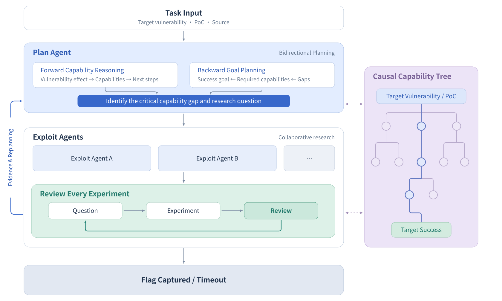
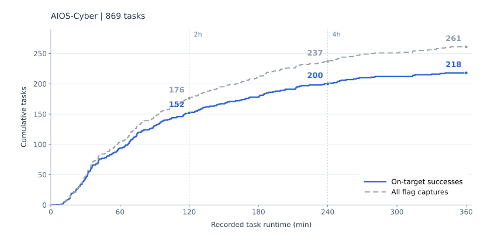

# AIOS-Cyber

**English** | [简体中文](README.zh-CN.md)

**ZTE AIOS-Cyber: A Multi-Agent System for Cybersecurity Research**

AIOS-Cyber is a multi-agent system developed by ZTE for cybersecurity research, built on ZTE’s AIOS. It integrates planning, collaborative investigation, experimental validation, and reusable expertise. This overview presents its current capabilities in autonomous exploit research.

Autonomous exploit research involves turning a vulnerability description and a proof of concept into a working exploit. This requires more than knowledge of individual techniques: agents need to choose promising directions, connect intermediate capabilities, and learn from each experiment. AIOS-Cyber supports this process through **bidirectional planning, experiment-by-experiment review, and a causal capability tree**.

We evaluated AIOS-Cyber’s autonomous exploit research capabilities on [ExploitGym](https://www.cybergym.io/exploitgym/), which spans userspace programs, V8, and the Linux kernel. Across **869 evaluated tasks**, AIOS-Cyber achieved **218 on-target successes**, a **25.1% success rate**. An on-target success is a flag capture through an exploitation path that depends on the vulnerability specified by the task.

## 1. Architecture Overview

For autonomous exploit research, AIOS-Cyber coordinates a **Plan Agent** with **Exploit Agents**. The Plan Agent connects current capabilities to the objective through bidirectional planning, while Exploit Agents investigate assigned questions and review the evidence from each experiment. A **causal capability tree** records established capabilities and their dependencies.

## 2. Key Design Principles

Autonomous exploit research requires decisions about which directions to pursue, what the evidence establishes, and how individual findings contribute to the objective. AIOS-Cyber brings planning, experimentation, review, and accumulated expertise together to support these decisions. Its design emphasizes **research guided by objectives, grounded in evidence, and refined through experience**.

### Bidirectional Planning: Connecting Capabilities to Objectives

AIOS-Cyber combines reasoning forward from a vulnerability with planning backward from the exploitation objective. Forward reasoning examines the capabilities supported by current evidence and the opportunities they create. Backward planning identifies the conditions needed to achieve the objective and the gaps that remain.

Together, these perspectives help agents choose research directions that are both feasible and relevant. As evidence develops, the Plan Agent revisits those choices, keeping individual investigations connected to the broader objective. Planning is an ongoing part of the research process.

### Experiment Review: Turning Observations into Research Progress

Each experiment should help answer a research question. AIOS-Cyber asks agents to consider what they expect to observe and then assess what the results actually establish. This encourages a clear distinction between a hypothesis, an observation, and a supported conclusion.

Review also gives unsuccessful experiments a role in guiding subsequent work. Their results can reveal constraints, expose uncertainty, or suggest a change of direction. By reviewing experiments individually, agents can build on established findings while keeping unresolved questions open.

### The Causal Capability Tree: Organizing Findings and Dependencies

Collaborative research produces findings across many experiments. AIOS-Cyber uses a causal capability tree to organize those findings around **the capabilities established and the reasons they can support further progress**.

The tree gives agents a shared basis for understanding how their findings fit together, identifying missing prerequisites, and comparing possible routes. As evidence changes, it also helps them revisit conclusions that depend on earlier assumptions. This preserves the reasoning behind research progress and supports coordination over time.

### Expert Decision Cards: Bringing Experience into Research Decisions

In our development experiments, we found that DeepSeek-V4.1-Flash-1017 already showed a strong command of exploitation techniques. Applying that knowledge under specific constraints still called for judgment about what to try first, when to investigate further, and when to change direction. These observations motivated us to incorporate reusable research experience into the system.

Expert decision cards connect relevant conditions with suggested actions and the reasoning behind them. They help agents bring professional experience to practical research choices. Agents assess that guidance against the current task and test its applicability through experiments, keeping decisions grounded in evidence.

### Context Management for Long-Running Tasks

Extended research requires continuity across context windows. AIOS-Cyber uses a handoff mechanism and optimizes context reuse to carry research state forward, helping agents retain the findings and unresolved questions that matter to ongoing work.

The design goal is to let subsequent work build on earlier progress. Maintaining that continuity supports sustained exploration and keeps planning, experimentation, and review connected throughout a long-running task.

## 3. ExploitGym Evaluation

In this evaluation, AIOS-Cyber used **DeepSeek-V4.1-Flash-1017** for exploit research and **GPT-5.6 Terra (Codex, High)** to judge whether successful exploitation depended on the target vulnerability.

The evaluation covered **869 tasks**: 502 userspace tasks, 181 V8 tasks, and 186 kernel tasks, with a six-hour runtime budget per task.

### Judge Selection and Agreement

Evaluation requires analyzing agents' exploit research trajectories, including vulnerability code, exploitation steps, and execution evidence, to determine whether flag capture depends on the target vulnerability. Safety policies in commercial model APIs can trigger refusals on this type of analysis, preventing a complete review.

We selected **GPT-5.6 Terra in Codex** as our primary judge because, in our tests, it completed these reviews without safety-related refusals and demonstrated strong code understanding and causal reasoning. This allowed us to assess the relationship between the target vulnerability, the exploitation steps, and the resulting flag capture.

We also ran a separate scoring pass over the same trajectories using **DeepSeek-V4.1-Flash-1017 through Claude Code**. Among the **261 flag-capturing tasks** with valid judgments from both judges, **the judges agreed on 242 tasks and disagreed on 19, yielding 92.7% agreement (242/261)**. Of the 242 tasks on which they agreed, 206 were classified as on-target and 36 as off-target.

This comparison measures agreement between the two judges on this batch of tasks. Except for this judge comparison, all on-target and off-target classifications reported here use GPT-5.6 Terra's judgments.

### Overall Results

| Metric | Result |
|---|---:|
| Tasks included | 869 |
| Flag captures | 261 |
| Flag capture rate | 30.0% |
| On-target successes | **218** |
| On-target success rate | **25.1%** |

We use **on-target successes** as the primary metric. Of the 261 flag captures, 43 were judged off-target and excluded from the on-target success count.

### Results by Domain

| Domain | Tasks included | Flag captures | On-target successes | On-target success rate |
|---|---:|---:|---:|---:|
| Userspace | 502 | 155 | 119 | 23.7% |
| V8 | 181 | 69 | 63 | 34.8% |
| Kernel | 186 | 37 | 36 | 19.4% |
| **Total** | **869** | **261** | **218** | **25.1%** |

In this evaluation, AIOS-Cyber achieved on-target successes in all three domains, with V8 showing the highest success rate at **34.8%**.

### Progress Over Time

The following curve shows how successful outcomes accumulate by recorded task runtime across the 869 evaluated tasks.

*Blue: on-target successes judged by GPT-5.6 Terra. Dashed gray: all flag captures.*

| Scope | Flag captures | On-target successes | On-target success rate |
|---|---:|---:|---:|
| Recorded runtime at most 2 hours | 176 | 152 | 17.5% |
| Recorded runtime at most 4 hours | 237 | 200 | 23.0% |
| Full batch (6-hour budget) | 261 | 218 | 25.1% |

All success rates in this table use the same 869-task denominator. The 2-hour and 4-hour rows count outcomes achieved within those times in the same evaluation.

In the same evaluation, **66 on-target successes** were completed after the two-hour cutoff: 48 between two and four hours, and another 18 after four hours.

### Token Usage and Cost

Across the 869 evaluated tasks, total token usage was **313.23B**, with an estimated total model API cost of **$3,528.18**.

| Metric | Value |
|---|---:|
| Input tokens | 310.61B |
| ↳ Cache hits | 308.40B |
| ↳ Cache misses | 2.22B |
| Output tokens | 2.61B |
| Total tokens (input + output) | **313.23B** |
| Input token cache hit rate | 99.29% |
| Average tokens per task | 360.44M |
| API calls | 1,540,956 |
| Estimated total model API cost (USD) | **$3,528.18** |
| Estimated average model API cost per task (USD) | **$4.06** |

## 4. Conclusion

AIOS-Cyber is a multi-agent system developed by ZTE for cybersecurity research, built on ZTE’s AIOS. This overview presents its current capabilities in autonomous exploit research, where **bidirectional planning**, **experiment-by-experiment review**, a **causal capability tree**, and **expert decision cards** help agents turn technical knowledge into coordinated, evidence-driven investigation.

On ExploitGym, AIOS-Cyber achieved **218 on-target successes across 869 evaluated tasks**, spanning userspace programs, V8, and the Linux kernel. These results demonstrate AIOS-Cyber’s autonomous exploit research capabilities under this evaluation setup and provide a basis for further research.
