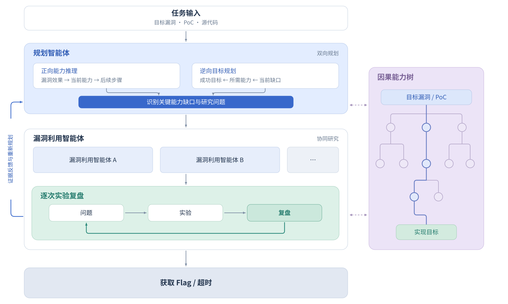
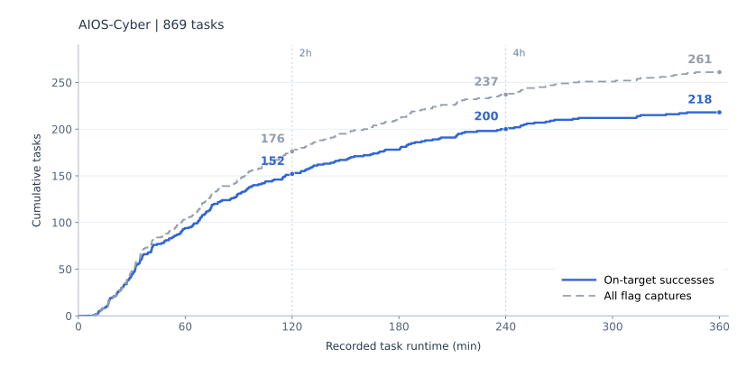

# AIOS-Cyber

[English](README.md) | **简体中文**

**ZTE AIOS-Cyber：面向网络空间安全的多智能体系统**

AIOS-Cyber 是中兴通讯基于自研 AIOS 研发的网络空间安全多智能体系统。系统整合规划、协同研究、实验验证和可复用的专业经验。本文展示其当前在自主漏洞利用研究方面的能力。

自主漏洞利用研究需要将漏洞描述和概念验证程序（PoC）转化为可用的漏洞利用程序。这不仅需要掌握单项技术，还要求智能体选择有潜力的研究方向，衔接各阶段的能力，并从每次实验中学习。AIOS-Cyber 通过**双向规划、逐次实验复盘和因果能力树**来支持这一过程。

我们在 [ExploitGym](https://www.cybergym.io/exploitgym/) 上评估了 AIOS-Cyber 的自主漏洞利用研究能力，该基准涵盖用户态程序、V8 和 Linux 内核。在 **869 项评估任务**中，AIOS-Cyber 实现了 **218 次目标漏洞利用成功**，**成功率为 25.1%**。目标漏洞利用成功（on-target success）是指通过依赖任务指定漏洞的利用路径获取 flag。

## 1. 架构概览

在自主漏洞利用研究场景中，AIOS-Cyber 协调 **规划智能体（Plan Agent）** 与 **漏洞利用智能体（Exploit Agents）** 开展工作。规划智能体通过双向规划将当前能力与目标连接起来，漏洞利用智能体则研究分配到的问题，并复盘每次实验产生的证据。**因果能力树**记录已确立的能力及其依赖关系。

## 2. 关键设计理念

自主漏洞利用研究需要持续判断哪些方向值得探索、哪些发现已经得到验证，以及局部进展如何支撑最终目标。AIOS-Cyber 将规划、实验、复盘和经验积累结合起来，支持多智能体共同做出这些判断。其设计强调**以目标引导探索，以证据积累能力，并在研究过程中持续修正判断**。

### 双向规划：连接当前能力与目标

AIOS-Cyber 将从漏洞出发的正向推理与从目标出发的逆向规划相结合。正向推理关注当前证据支持哪些能力，以及这些能力可以带来哪些探索机会；逆向规划关注实现目标所需的条件，以及当前尚未补齐的缺口。

两个视角共同帮助智能体选择既可行、又有助于推进目标的研究方向。随着新证据积累，规划智能体持续评估和调整路径，让各智能体的局部探索与整体目标保持联系。规划因此贯穿整个研究过程。

### 实验复盘：将观察结果转化为研究进展

每次实验都应服务于一个明确的研究问题。AIOS-Cyber 引导智能体对照预期效果审视实际结果，判断哪些认识获得了支持，哪些问题仍需探索。这一设计强调对研究假设、实验观察和已验证结论的区分。

未达到预期的实验同样可以提供研究依据，帮助智能体理解约束、识别不确定性或调整方向。通过逐次复盘，后续研究能够建立在已验证的发现之上，并围绕尚未解决的问题继续推进。

### 因果能力树：组织研究成果与依赖关系

协同研究会产生大量分散的实验发现。AIOS-Cyber 使用因果能力树，将这些发现组织起来，记录**已经确立了哪些能力，以及这些能力为什么能够支持后续进展**。

因果能力树为多智能体提供共同的研究依据，帮助它们理解各项发现之间的联系、识别必要条件的缺口，并比较不同路径。随着证据变化，智能体也可以重新审视依赖早期判断的结论，使研究进展及其依据得到持续积累。

### 专家决策卡：将专业经验融入研究决策

在开发实验中，我们认为 DeepSeek-V4.1-Flash-1017 已具备较强的漏洞利用技术能力。在具体约束下运用这些知识，还需要判断优先尝试什么、何时继续深入，以及何时调整方向。因此，我们将可复用的研究经验引入系统，为这些决策提供支持。

专家决策卡将适用条件、行动建议及其理由联系起来，帮助智能体将专业经验运用于实际研究。智能体结合当前任务评估这些建议，并通过实验检验其适用性，使经验指导与证据验证相互衔接。

### 长程任务的上下文管理优化

长时间研究需要跨越多个上下文窗口，持续保留与当前任务相关的发现和未决问题。AIOS-Cyber 通过交接（handoff）机制传递研究状态，并优化上下文复用，支持研究过程的连续开展。

这一设计的目标是让后续工作能够承接此前形成的判断和进展，使规划、实验与复盘在上下文切换后继续衔接，为长程探索提供支持。

## 3. ExploitGym 评估

本次评估中，AIOS-Cyber 使用 **DeepSeek-V4.1-Flash-1017** 开展漏洞利用研究，并使用 **GPT-5.6 Terra（Codex，High）** 判断成功的漏洞利用是否依赖目标漏洞。

评估涵盖 **869 项任务**：502 项用户态任务、181 项 V8 任务和 186 项内核任务，每项任务的运行时间预算为六小时。

### 评判模型选择与判定一致性

评估需要分析智能体的漏洞利用研究轨迹，包括漏洞代码、利用步骤和执行证据，以判断 flag 的获取是否依赖目标漏洞。商业模型 API 的安全策略可能对这类分析触发拒答，影响评审的完整性。

我们选择 **Codex 中的 GPT-5.6 Terra** 作为主要评判模型，是因为它在我们的测试中能够完成这类评审，未因安全策略拒绝相关分析，同时具备较强的代码理解和因果推理能力。这使我们能够评估目标漏洞、利用步骤与最终获取 flag 之间的因果关系。

我们还通过 **Claude Code 调用 DeepSeek-V4.1-Flash-1017**，对同一批执行轨迹进行了独立评分。在两个评判模型均给出有效判定的 **261 项成功获取 flag 的任务**中，**242 项判定一致，19 项存在分歧，一致率为 92.7%（242/261）**。在判定一致的 242 项任务中，206 项被判定为依赖目标漏洞（on-target），36 项被判定为不依赖目标漏洞（off-target）。

这项比较反映了两个评判模型在该批任务上的判定一致程度。除上述评判模型对比外，本文报告的 on-target 和 off-target 分类均以 GPT-5.6 Terra 的判定为依据。

### 总体结果

| 指标 | 结果 |
|---|---:|
| 评估任务数 | 869 |
| 成功获取 flag 的任务数 | 261 |
| Flag 获取成功率 | 30.0% |
| 目标漏洞利用成功数 | **218** |
| 目标漏洞利用成功率 | **25.1%** |

我们以**目标漏洞利用成功数**作为主要指标。在 261 次成功获取 flag 的结果中，有 43 次被判定为不依赖目标漏洞，因此未计入目标漏洞利用成功数。

### 分领域结果

| 领域 | 评估任务数 | 成功获取 flag 的任务数 | 目标漏洞利用成功数 | 目标漏洞利用成功率 |
|---|---:|---:|---:|---:|
| 用户态 | 502 | 155 | 119 | 23.7% |
| V8 | 181 | 69 | 63 | 34.8% |
| 内核 | 186 | 37 | 36 | 19.4% |
| **总计** | **869** | **261** | **218** | **25.1%** |

本次评估中，AIOS-Cyber 在三个领域均实现了目标漏洞利用成功，其中 V8 的成功率最高，为 **34.8%**。

### 随运行时间累积的进展

下图展示了 869 项评估任务中，成功结果随任务记录运行时间的累积情况。

*蓝色：GPT-5.6 Terra 判定的目标漏洞利用成功。灰色虚线：所有成功获取 flag 的结果。*

| 范围 | 成功获取 flag 的任务数 | 目标漏洞利用成功数 | 目标漏洞利用成功率 |
|---|---:|---:|---:|
| 记录运行时间不超过 2 小时 | 176 | 152 | 17.5% |
| 记录运行时间不超过 4 小时 | 237 | 200 | 23.0% |
| 完整批次（6 小时预算） | 261 | 218 | 25.1% |

本表中的成功率均以 869 项任务为分母。2 小时和 4 小时两行分别统计同一次评估中在相应时间内取得的结果。

在同一次评估中，有 **66 次目标漏洞利用成功**在两小时截止点之后完成：其中 48 次在两到四小时之间完成，另有 18 次在四小时之后完成。

### Token 用量与费用

869 项评估任务共使用 **313.23B Token（约 3,132.25 亿）**，模型调用总费用估算为 **$3,528.18**。

| 指标 | 数值 |
|---|---:|
| 输入 Token | 310.61B |
| ↳ 缓存命中 | 308.40B |
| ↳ 缓存未命中 | 2.22B |
| 输出 Token | 2.61B |
| 总 Token（输入＋输出） | **313.23B** |
| 输入 Token 缓存命中率 | 99.29% |
| 平均每项任务 Token 用量 | 360.44M |
| API 调用次数 | 1,540,956 |
| 模型调用总费用估算（美元） | **$3,528.18** |
| 平均每项任务模型调用费用估算（美元） | **$4.06** |

## 4. 总结

AIOS-Cyber 是中兴通讯基于自研 AIOS 研发的网络空间安全多智能体系统。本文展示了其当前的自主漏洞利用研究能力：通过**双向规划**、**逐次实验复盘**、**因果能力树**和**专家决策卡**，帮助智能体运用技术知识，开展以证据为依据的协同研究。

在 ExploitGym 上，AIOS-Cyber 在 **869 项评估任务中实现了 218 次目标漏洞利用成功**，覆盖用户态程序、V8 和 Linux 内核。这些结果展示了 AIOS-Cyber 在本次评估设置下的自主漏洞利用研究能力，可为后续研究提供参考。
